# Analytics de Operações de Crédito e Pipeline de Dados


> **Estudo de caso público para portfólio, baseado em um projeto real de analytics de operações de crédito.** Dados pessoais, informações de clientes, identificadores confidenciais, credenciais de produção e dados proprietários foram excluídos ou anonimizados. Os valores exibidos nas evidências públicas dos dashboards são simulados.

## Visão geral

Este projeto documenta uma solução de operações de crédito que combina atividades práticas de **engenharia de dados** com uma **aplicação analítica Qlik** para acompanhamento executivo, análise comercial, priorização de oportunidades, desempenho financeiro e conciliação.

O portfólio documenta intencionalmente dois componentes complementares:

1. **Engenharia de dados** — ingestão de planilhas e arquivos operacionais, limpeza, tipagem, normalização, modelagem relacional e carga no MySQL com Python / Pandas e SQLAlchemy / PyMySQL.
2. **Analytics Qlik** — conjuntos de dados analíticos preparados, estruturas QVD, modelagem associativa, regras de negócio, pontuação de oportunidades, KPIs e dashboards.

> A documentação pública **não afirma existir uma linhagem automatizada diretamente validada entre a camada de preparação MySQL e a camada QVD**, a menos que essa conexão tenha sido verificada explicitamente.

## Componentes da solução

```text
COMPONENTE DE ENGENHARIA DE DADOS
Fontes Operacionais / Planilhas
              |
              v
      ETL com Python + Pandas
              |
              v
 Limpeza / Validação de Tipos
              |
              v
 Transformações de Negócio
              |
              v
 Normalização Relacional
              |
              v
 SQLAlchemy / PyMySQL
              |
              v
            MySQL

COMPONENTE ANALÍTICO QLIK
Fontes Analíticas Preparadas
              |
              v
     QVD / Camada de Preparação
              |
              v
 Modelo Associativo do Qlik
              |
              v
 Regras de Negócio / Medidas
              |
              v
     Aplicação Analítica
```

Consulte [Arquitetura](architecture/README.md).

## Trabalho de engenharia de dados

O componente de engenharia de dados inclui atividades práticas de ETL, como:

- ingestão de planilhas com **Python / Pandas**;
- validação e normalização de tipos de dados;
- tratamento de valores nulos e textos vazios;
- preparação de campos de data e numéricos;
- preservação de identificadores de contratos de crédito;
- normalização de campos repetidos de liberação;
- carga em banco de dados relacional com **SQLAlchemy / PyMySQL**;
- modelagem e validação do destino MySQL;
- resolução de incompatibilidades de schema e tipos.

Um problema representativo envolveu identificadores de contratos contendo hífens e barras. Esses identificadores precisaram ser modelados como **texto, e não como valores numéricos**, para preservar a chave de negócio original.

Outra transformação converteu campos repetidos de liberação em uma estrutura normalizada, em vez de manter um modelo amplo no formato típico de planilhas.

Consulte [ETL e Engenharia de Dados](etl/README.md).

## Modelo analítico Qlik

A aplicação analítica consolida áreas como:

- contratos;
- propostas;
- clientes;
- vínculos comerciais / relacionamentos de carteira;
- metas e estruturas regionais;
- pontuação de oportunidades;
- desempenho de gestores;
- métricas financeiras;
- monitoramento de conciliação e inadimplência.

A camada Qlik utiliza conjuntos de dados analíticos preparados e estruturas baseadas em QVD para sustentar um modelo associativo entre as perspectivas operacional, comercial, financeira e gerencial.

Consulte [Modelo de Dados](data-model/README.md).

## Aplicação analítica

A aplicação está organizada em seis visões de negócio:

1. **Visão Executiva** — produção, contratos, clientes, receita, comissão, recorrência, evolução, composição das operações, desempenho em relação às metas e diferenças para as metas.
2. **Funil Comercial** — volume de propostas, taxas de decisão e aprovação, valores não convertidos, propostas em andamento, monitoramento de SLA e análises regionais e por gestor.
3. **Carteira e Oportunidades** — oportunidades qualificadas, potencial financeiro estimado, classificação de prioridade, maturidade, recorrência e radar de oportunidades.
4. **Resultados Financeiros** — produção, receita estimada, comissão, spread, CET, composição das operações, participação de parceiros e evolução financeira.
5. **Desempenho Comercial** — resultados realizados, eficiência do funil, potencial de oportunidades e priorização por gestor.
6. **Conciliação e Inadimplência** — valores esperados, descontados e transferidos, exposição, falhas, envelhecimento, causas de conciliação e filas de ação.

Consulte [Dashboards e Visões de Negócio](dashboards/README.md).

## Galeria de dashboards

### 1. Visão Executiva

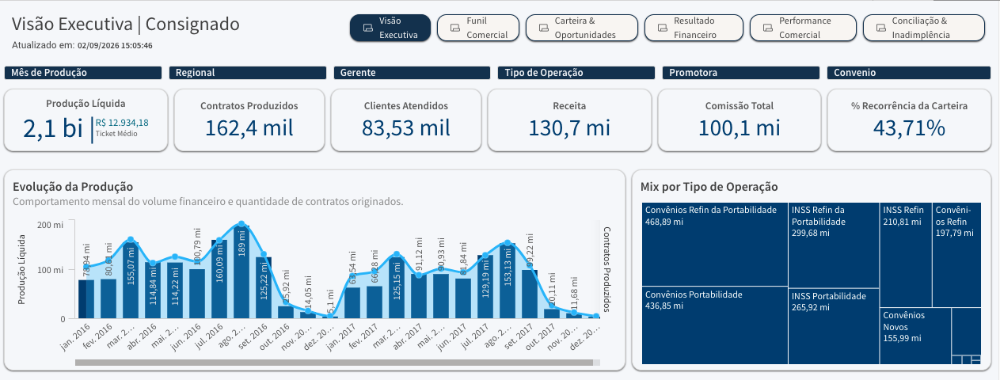

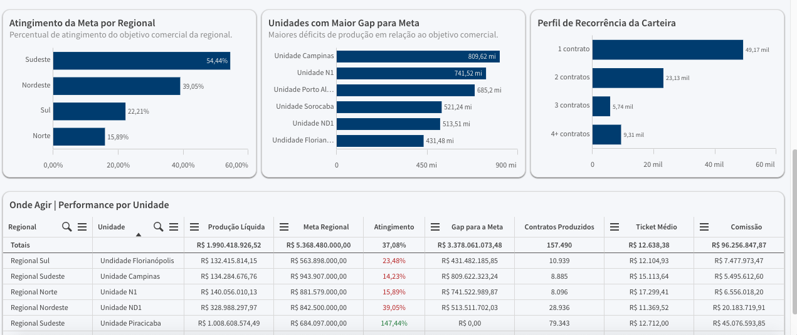

### 2. Funil Comercial

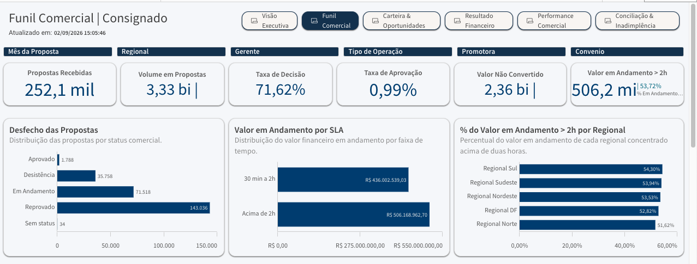

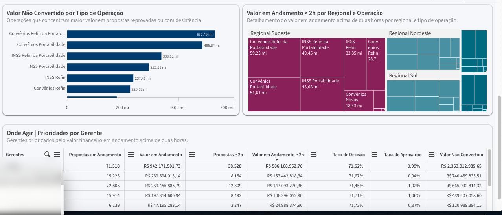

### 3. Carteira e Oportunidades

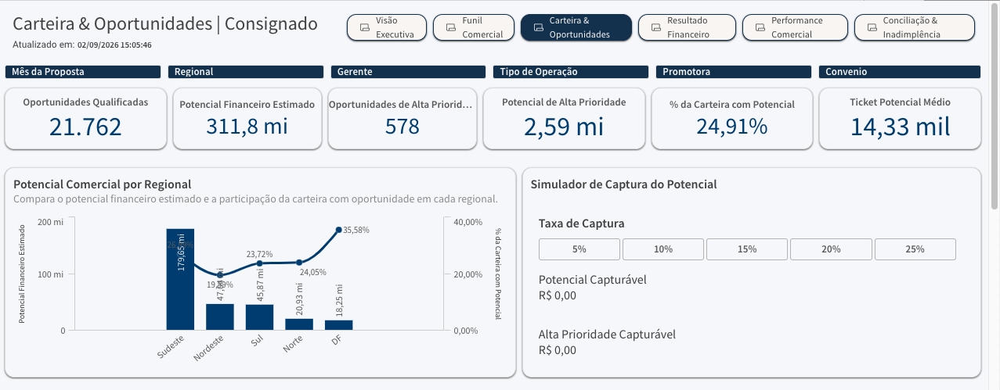

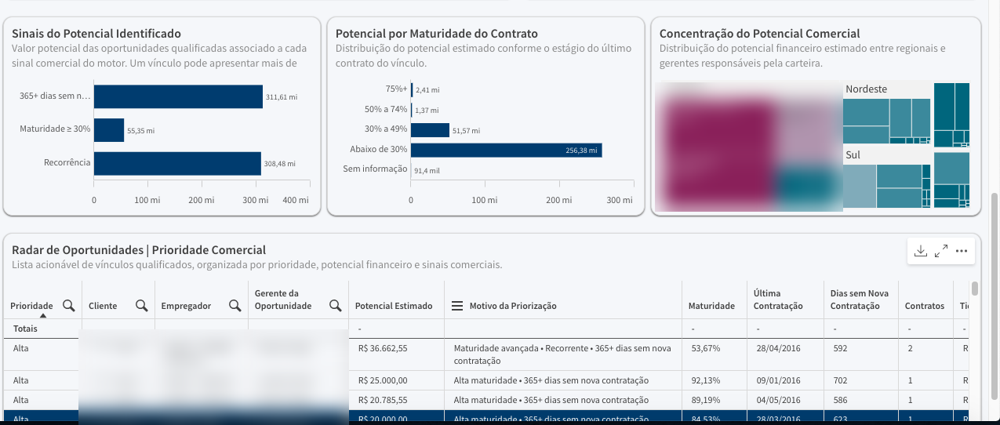

### 4. Resultados Financeiros

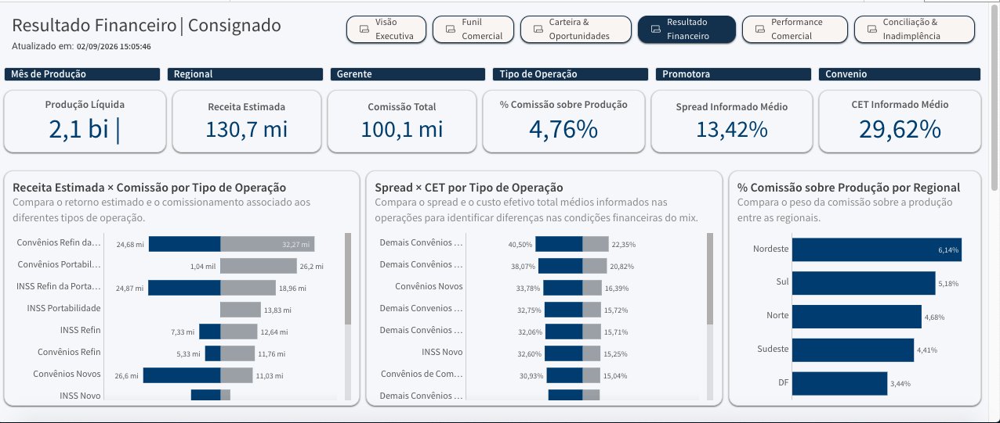

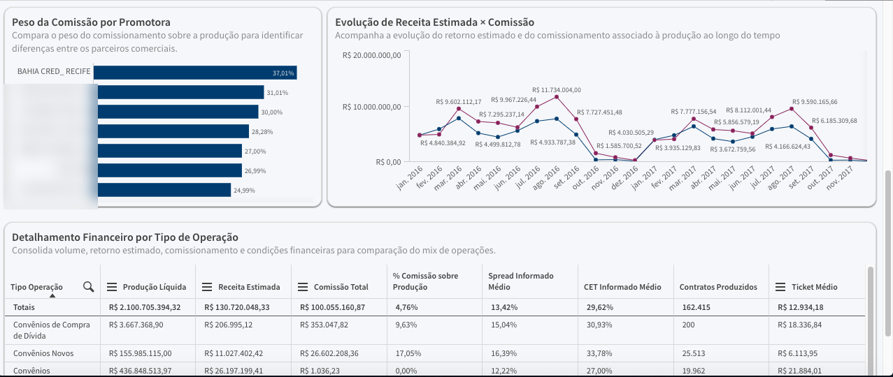

### 5. Desempenho Comercial

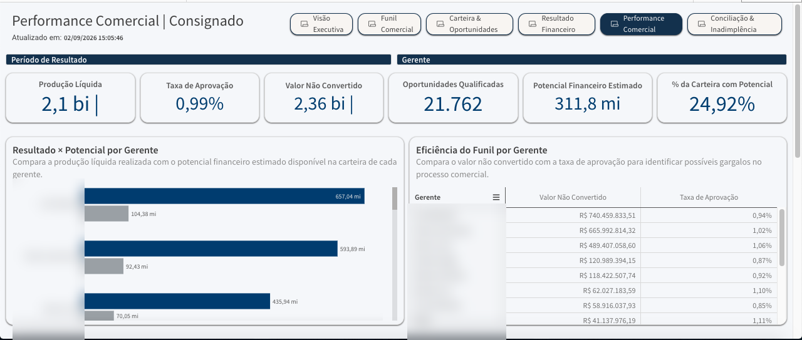

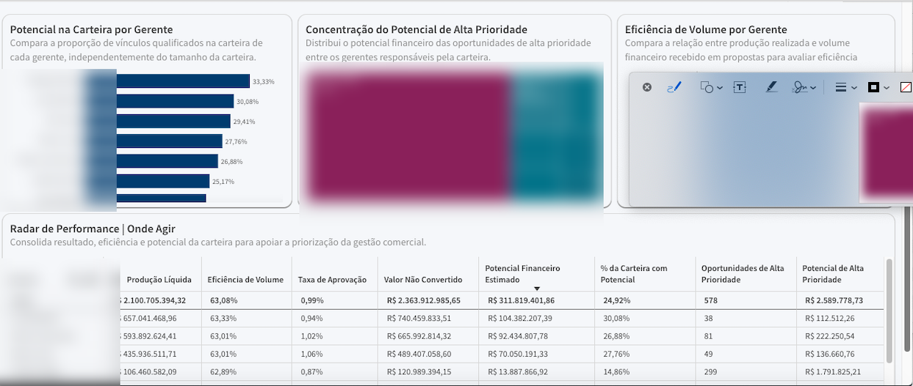

### 6. Conciliação e Inadimplência

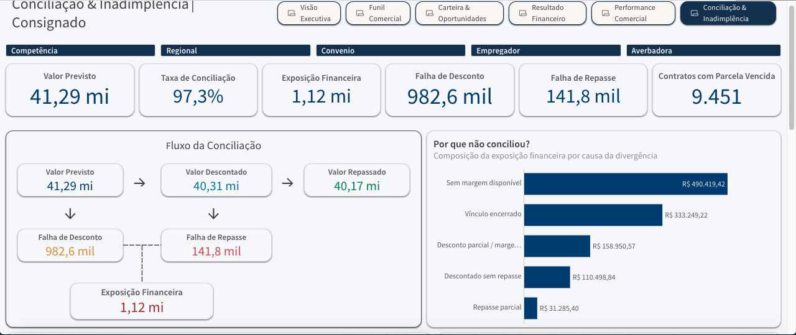

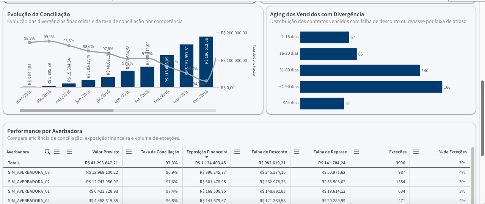

> As capturas de tela foram tratadas para apresentação pública e utilizam valores analíticos simulados.

## Pontuação de oportunidades

O modelo analítico inclui uma camada de priorização de oportunidades que utiliza sinais como:

```text
Vencimento do Contrato
      +
Recorrência
      +
Tempo desde o Último Contrato
      +
Relacionamento com a Carteira
      ↓
Pontuação da Oportunidade
      ↓
Classificação de Prioridade
      ↓
Potencial Financeiro Estimado
```

O portfólio público documenta o conceito analítico sem expor os pesos proprietários utilizados na pontuação.

Consulte [Regras de Negócio e Pontuação de Oportunidades](business-rules/README.md).

## Tecnologias

| Camada | Tecnologias |
|---|---|
| Ingestão de dados | Excel / arquivos operacionais estruturados |
| ETL | Python, Pandas |
| Integração com banco de dados | SQLAlchemy, PyMySQL |
| Banco de dados relacional | MySQL |
| Preparação analítica | QVD, Qlik Script |
| Analytics | Qlik Sense / Qlik Cloud |
| Modelagem | Modelo de Dados Associativo |
| Analytics de negócio | KPIs, medidas calculadas, pontuação de oportunidades |

## Principais desafios técnicos

- Tipos de dados incorretos na origem
- Textos vazios misturados com valores numéricos
- Tratamento de inteiros que aceitam valores nulos
- Preservação de identificadores de negócio
- Normalização de colunas repetidas em planilhas
- Erros de carga em banco de dados relacional
- Validação de dados entre componentes de engenharia e analytics
- Integração das perspectivas operacional, comercial, financeira e de conciliação
- Transformação do comportamento da carteira em sinais acionáveis de oportunidade

## Privacidade e segurança do portfólio

O projeto original contém informações sensíveis de crédito e clientes. As capturas de tela públicas foram selecionadas e tratadas antes da publicação, e os valores analíticos apresentados nesta versão do portfólio são simulados.

O repositório **não publica CPF ou identificadores pessoais, nomes de clientes, credenciais de produção, detalhes internos de infraestrutura, conjuntos de dados confidenciais ou pesos proprietários de pontuação**.

Consulte [Privacidade e Anonimização](privacy/README.md).

## Estrutura do repositório

```text
.
├── README.md
├── PROJECT_SCOPE.md
├── architecture/
│   └── README.md
├── etl/
│   └── README.md
├── data-model/
│   └── README.md
├── business-rules/
│   └── README.md
├── dashboards/
│   └── README.md
├── privacy/
│   └── README.md
└── screenshots/
    ├── README.md
    └── consignado_portfolio_screenshots_sanitized/
```

## Documentação

- [Escopo Validado do Projeto](PROJECT_SCOPE.md)
- [Arquitetura](architecture/README.md)
- [ETL e Engenharia de Dados](etl/README.md)
- [Modelo de Dados](data-model/README.md)
- [Regras de Negócio e Pontuação de Oportunidades](business-rules/README.md)
- [Dashboards e Visões de Negócio](dashboards/README.md)
- [Privacidade e Anonimização](privacy/README.md)
- [Evidências em Capturas de Tela](screenshots/README.md)

---

**Projeto de portfólio de Luiz Felipe Nunes — Desenvolvedor de BI | Qlik | SQL | Python | Análise de Dados**
