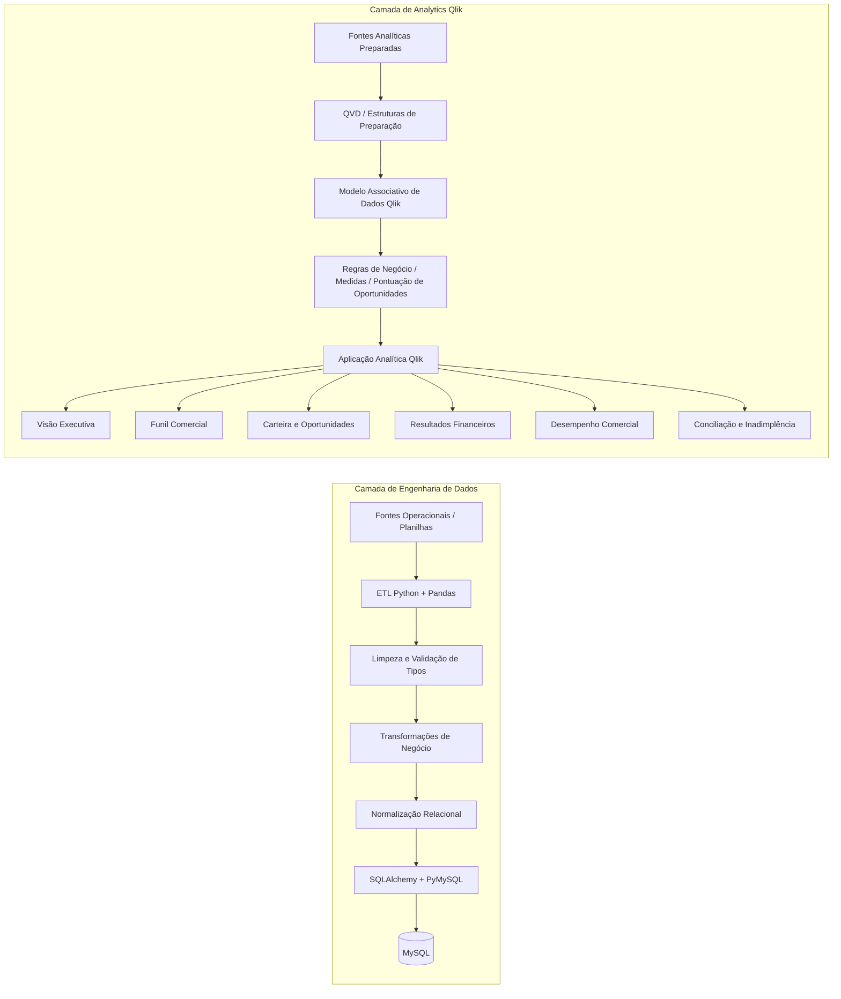

# Arquitetura

## Visão geral

Este estudo de caso de portfólio documenta dois componentes complementares da solução de operações de crédito:

1. uma **camada de engenharia de dados**, construída com Python, Pandas, SQLAlchemy / PyMySQL e MySQL;
2. uma **camada de analytics Qlik**, construída a partir de conjuntos de dados analíticos preparados, estruturas QVD, modelagem associativa, regras de negócio e dashboards.

A documentação pública mantém intencionalmente esses componentes separados. Ela **não afirma existir uma linhagem automatizada diretamente validada entre a camada de preparação MySQL e a camada QVD**, a menos que essa conexão esteja explicitamente documentada e verificada.

## Visão da arquitetura

## 1. Camada de engenharia de dados

A origem operacional continha contratos de crédito, propostas, informações de clientes, valores financeiros, taxas, comissões, dados de liberação, atributos organizacionais e outros campos de negócio.

Python e Pandas foram utilizados para limpar e estruturar os dados de origem antes da carga relacional. O trabalho prático incluiu:

- validação de colunas da origem;
- conversão de tipos de dados;
- tratamento de valores nulos e textos vazios;
- preparação de campos numéricos e datas;
- preservação de chaves de negócio;
- normalização de colunas repetidas em planilhas;
- criação de estruturas relacionais de saída.

Um exemplo representativo foi preservar identificadores de contratos como texto, pois a chave de negócio pode conter caracteres como hífens e barras.

Os conjuntos de dados transformados foram carregados no MySQL por meio de SQLAlchemy / PyMySQL para armazenamento estruturado e validação.

## 2. Preparação analítica Qlik

A aplicação Qlik utiliza conjuntos de dados analíticos preparados e organizados por estruturas baseadas em QVD e tabelas analíticas intermediárias.

O modelo analítico cobre domínios como:

- contratos;
- propostas;
- clientes e relacionamentos de carteira;
- gestores e estruturas regionais;
- metas;
- oportunidades;
- medidas financeiras;
- eventos de conciliação.

## 3. Regras de negócio e lógica analítica

A camada semântica transforma dados preparados em indicadores orientados à tomada de decisão, incluindo:

- KPIs de produção e financeiros;
- métricas do funil de propostas;
- análise de SLA;
- análise de metas e diferenças;
- sinais de maturidade e recorrência de oportunidades;
- pontuação de oportunidades e classificação de prioridade;
- potencial financeiro estimado;
- exposição de conciliação e monitoramento de exceções.

## 4. Consumo pelo negócio

A aplicação Qlik final está organizada em seis visões analíticas:

1. Visão Executiva
2. Funil Comercial
3. Carteira e Oportunidades
4. Resultados Financeiros
5. Desempenho Comercial
6. Conciliação e Inadimplência

Em conjunto, essas visões vão do acompanhamento executivo até ações operacionais e comerciais.

## Princípios de arquitetura

- Preservar corretamente os identificadores de negócio
- Validar os dados antes da carga relacional
- Normalizar estruturas originadas em planilhas
- Manter as camadas de engenharia de dados e analytics claramente separadas
- Evitar afirmações de linhagem não comprovadas na documentação pública
- Converter dados operacionais em sinais de negócio acionáveis
- Proteger informações pessoais e confidenciais nas evidências públicas
