# Evidências em Capturas de Tela

## Objetivo

Esta pasta contém um conjunto selecionado de capturas de tela tratadas da aplicação Qlik.

O objetivo é demonstrar o design analítico e a cobertura de negócio sem publicar dados pessoais, identificadores confidenciais ou informações internas da empresa. Os valores exibidos nestas capturas públicas são simulados.

A aplicação é representada aqui por **seis dashboards analíticos, com duas capturas complementares para cada dashboard**.

## 1. Visão Executiva

A primeira tela apresenta a visão gerencial de alto nível, com produção, contratos, clientes, receita, comissão, recorrência, evolução mensal e composição das operações.

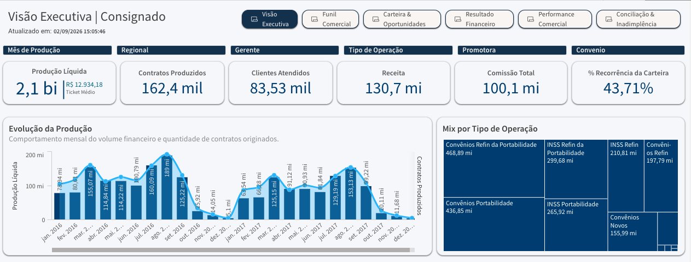

A segunda tela complementa a visão executiva com desempenho regional, atingimento de metas e análise das diferenças em relação às metas.

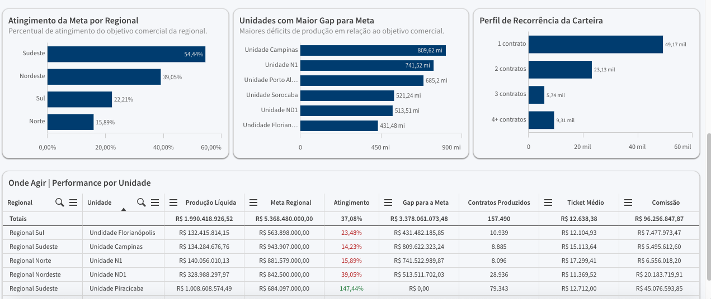

## 2. Funil Comercial

A primeira tela apresenta volume de propostas, taxas de decisão e aprovação, valor não convertido, valor em andamento e indicadores de SLA.

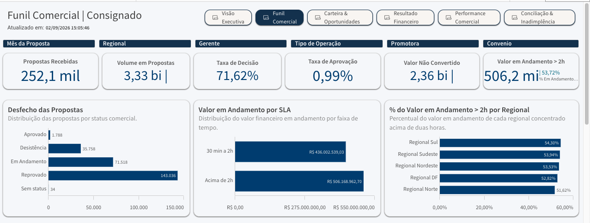

A segunda tela amplia a análise do funil com prioridades por gestor e acompanhamento operacional.

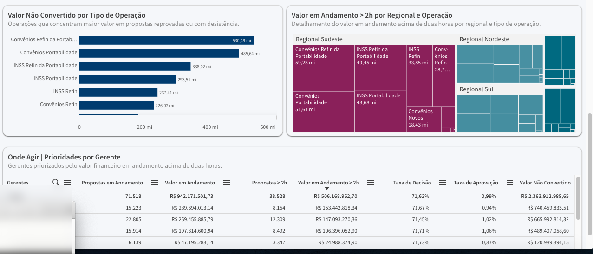

## 3. Carteira e Oportunidades

A primeira tela apresenta oportunidades qualificadas, potencial financeiro estimado, oportunidades de alta prioridade, potencial da carteira, distribuição regional e simulação de captação.

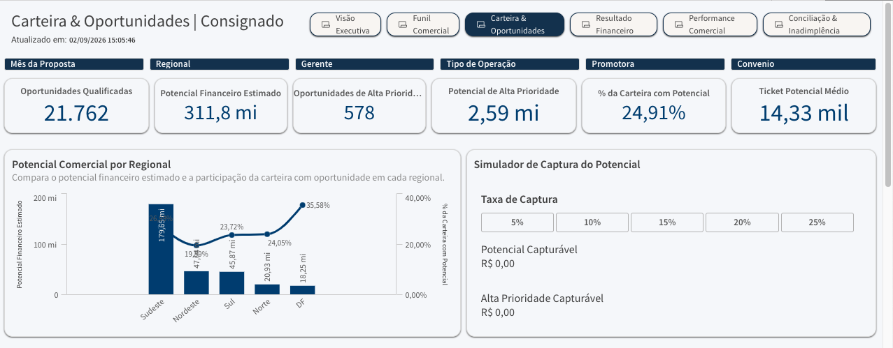

A segunda tela apresenta o radar de oportunidades orientado à ação, com base em maturidade, recorrência, tempo desde o último contrato, potencial estimado e classificação de prioridade.

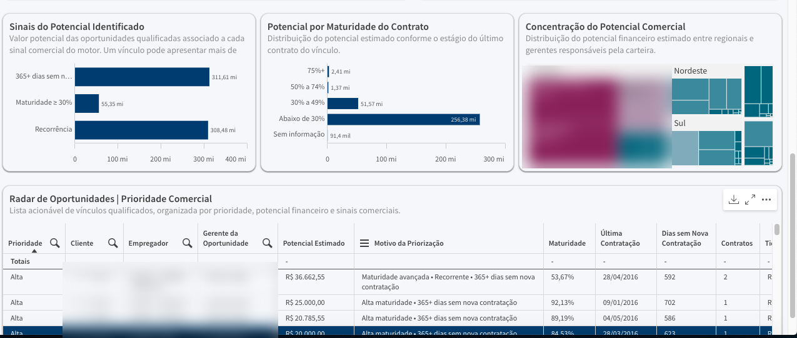

## 4. Resultados Financeiros

A primeira tela apresenta produção líquida, receita estimada, comissão total, relação comissão/produção, spread, CET e análise financeira comparativa.

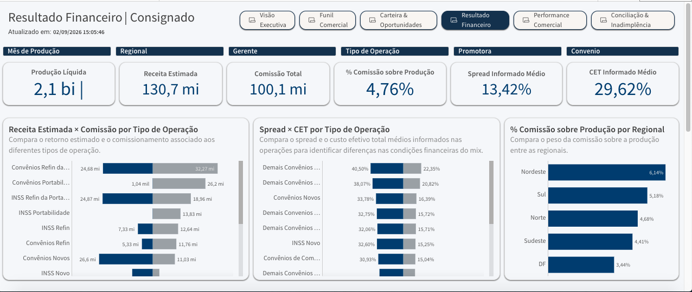

A segunda tela amplia a análise com detalhes financeiros por operação e parceiro comercial.

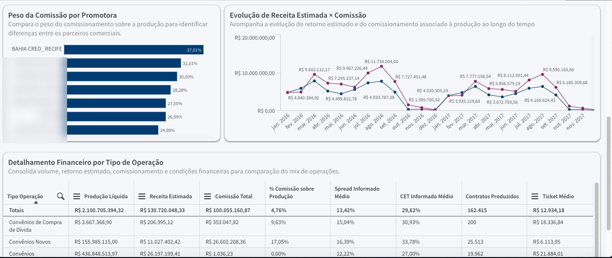

## 5. Desempenho Comercial

A primeira tela combina produção realizada, eficiência do funil, taxa de aprovação, valor não convertido e potencial de oportunidades da carteira.

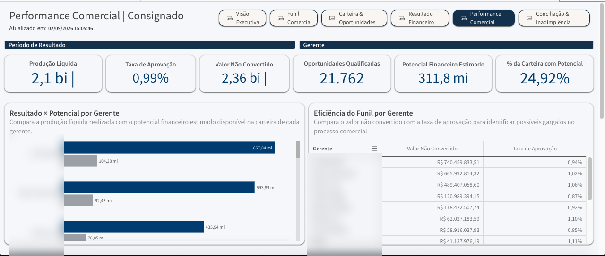

A segunda tela complementa a análise com um radar de desempenho e uma visão de priorização por gestor.

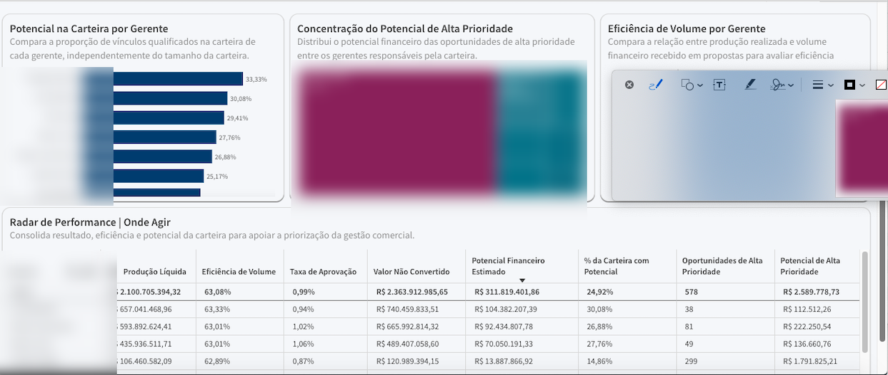

## 6. Conciliação e Inadimplência

A primeira tela apresenta valores esperados, descontados e transferidos, taxa de conciliação, exposição financeira, falhas, contratos em atraso e causas principais das divergências financeiras.

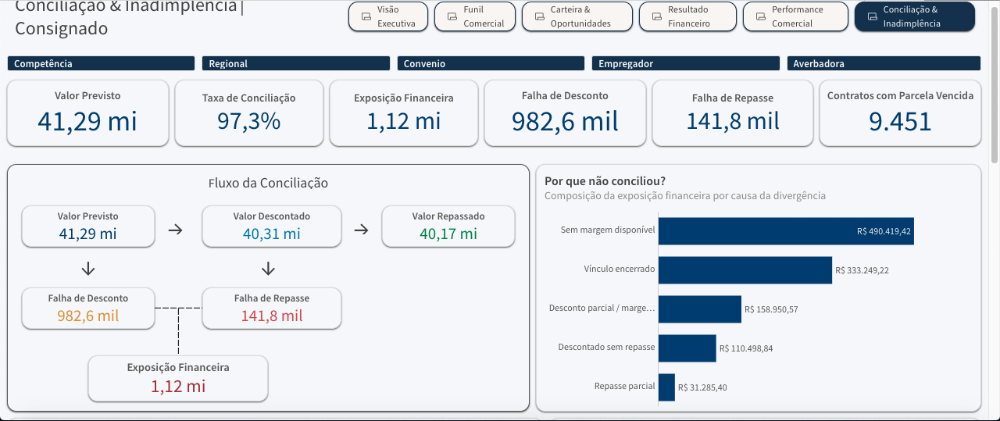

A segunda tela complementa a visão com evolução da conciliação, envelhecimento das exceções em atraso, desempenho por entidade e indicadores de acompanhamento operacional.

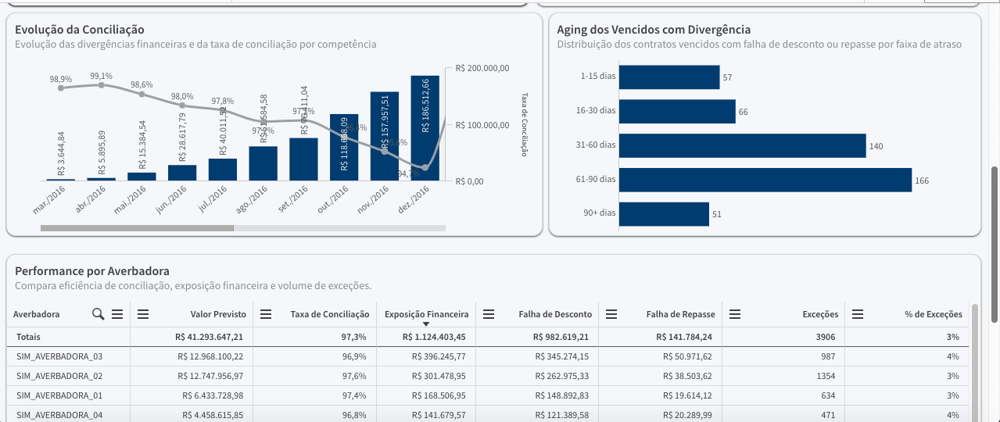

## Tratamento aplicado

Antes da publicação, o conjunto de evidências foi revisado para reduzir a exposição de informações identificáveis desnecessárias. As versões públicas incluem medidas como:

- remoção do cabeçalho com tenant / empresa / usuário do Qlik;
- mascaramento ou desfoque de nomes pessoais visíveis quando necessário;
- mascaramento de informações identificáveis em nível de registro quando necessário;
- exclusão de credenciais, informações de conexão e identificadores internos de infraestrutura;
- utilização de valores analíticos simulados no estudo de caso público.

## Estratégia de evidências

As doze capturas preservam a estrutura de duas telas de cada dashboard analítico, mantendo o estudo de caso público focado em valor de negócio, design analítico e apoio à tomada de decisão.
